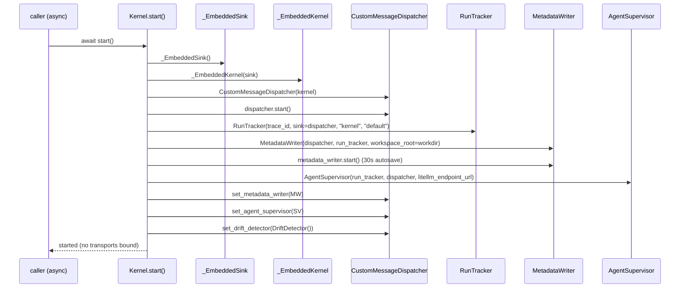
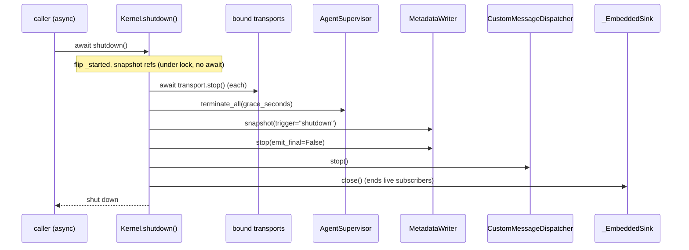

# Kernel facade architecture

**Status**: reference (slice 2). **Stability: unstable** — the public API
may change before the substrate trajectory's slice 4 lands; after that,
semantic versioning applies. The API is stamped unstable in the class
docstring itself.
**Source of truth**: [`kernel_facade.py`](../../../vendor/LLMKernel/llm_kernel/kernel_facade.py)
(read it for the authoritative signatures; every reference below was
verified against it).
**Related**: [`embedding.md`](embedding.md) (the library-embedding guide),
[`capture-invariants.md`](capture-invariants.md) (the substrate properties
the wiring exists to protect), [`identity-model.md`](identity-model.md)
(the identifiers the wiring threads), [`PLAN-kernel-facade.md`](../../06%20-%20Roadmaps/PLAN-kernel-facade.md)
(the slice-2 plan this implements).

## Purpose

`Kernel` is the **embeddable** face of the LLMKernel substrate. Before it,
the kernel could only be *spawned* as a subprocess: each entry point
(`transports/pty_mode.py`, `transports/serve_mode.py`, the dormant
`app.py` lifespan, the IPython `kernel.py`) hand-wired the same capture
subsystems in its own boot function. The facade hoists that construction
into a single class that **owns the subsystem references**, so the kernel
can be driven as a Python object:

```python
from llm_kernel import Kernel
```

This makes the substrate a **library**, not only a subprocess — a Python
script, a FastAPI app, or a Jupyter cell can construct a kernel, read its
event stream, and drive agents in-process. See [`embedding.md`](embedding.md)
for the async-only contract and worked examples.

The facade is **additive**. It is a new embeddable path; the known-good
`pty-mode` / `serve` subprocess entry points were deliberately *not*
refactored to consume it (see [Deviations from the plan](#deviations-from-the-original-plan)).

## Lifecycle

The facade is async-only and has exactly three ways to run: `start()` /
`shutdown()`, or the async context manager that wraps them.

| Method | Signature | Semantics |
|---|---|---|
| `start` | `async start() -> None` | Wire subsystems in canonical order. **Idempotent** — a second call while started returns immediately. Captures the running loop (`asyncio.get_running_loop()`) unless an explicit `loop=` was passed to `__init__`. Raises [`KernelStartError`](#kernelstarterror) on failure, never `os._exit`. |
| `shutdown` | `async shutdown() -> None` | Reverse the construction. **Idempotent** — a no-op if not started. Best-effort: each teardown step is independently guarded so one failure does not strand later cleanup. |
| `__aenter__` | `async __aenter__() -> Kernel` | Calls `start()`, returns `self`. |
| `__aexit__` | `async __aexit__(*_exc) -> None` | Calls `shutdown()`. |

The lifecycle transition is guarded by a `threading.Lock`. `shutdown()`
flips `_started` and captures the subsystem references **under the lock
with no `await` inside**, then does the async/blocking teardown outside
it — so it never blocks the event loop while holding a threading lock, a
concurrent `shutdown()` sees `_started` False and no-ops, and the sync
delegators start refusing immediately.

`start()` builds a **fresh** `_EmbeddedSink` on every call, so a
start-after-shutdown collects into a live (non-closed) buffer and any
subscribers of a prior run have already ended on that run's `sink.close()`.

### `KernelStartError`

```python
class KernelStartError(RuntimeError):
    def __init__(self, message: str, *, rc: Optional[int] = None) -> None: ...
    self.rc: Optional[int]
```

Raised when `start()` cannot wire the subsystems. It carries the
return-code `rc` the subprocess entry points would have exited with
(2 / 3 / 11 / 12 per [RFC-008](../../05%20-%20Standards/rfcs/RFC-008-kernel-host-integration.md)),
so a subprocess wrapper can translate it back into an exit code while an
embedded host stays alive. `rc` is `None` when the failure is not one of
the known boot-failure codes. This is the deliberate replacement for the
`os._exit(rc)` that the dormant `app.py` performs — hard-exiting the
process would kill an embedding host.

## Construction (wiring) sequence

`start()` reproduces the canonical wiring from
[`_kernel_hooks.attach_kernel_subsystems`](../../../vendor/LLMKernel/llm_kernel/_kernel_hooks.py)
**plus** the dispatcher-collaborator setters the pty transport performs
after boot (`transports/pty_mode.py`). The order:

1. Fresh `_EmbeddedSink()` and `_EmbeddedKernel(sink)` — the in-process
   kernel shell (see below).
2. `CustomMessageDispatcher(kernel)`, then `dispatcher.start()`.
3. `trace_id = uuid.uuid4().hex`; `RunTracker(trace_id=trace_id,
   sink=dispatcher, agent_id="kernel", zone_id="default")`.
4. `MetadataWriter(dispatcher=dispatcher, run_tracker=run_tracker,
   workspace_root=workdir)`, then `metadata_writer.start()` (30s autosave
   timer). **`workspace_root=`, not `event_log_path`** — there is no
   `events.jsonl` sink in the tree.
5. Resolve the LiteLLM endpoint URL: `config["litellm_endpoint_url"]` →
   `_DEFAULT_LITELLM_ENDPOINT` (`http://127.0.0.1:8000/v1`).
6. `AgentSupervisor(run_tracker=run_tracker, dispatcher=dispatcher,
   litellm_endpoint_url=url)`.
7. **Dispatcher collaborator wiring** (the setters `attach_kernel_subsystems`
   does *not* do): `dispatcher.set_metadata_writer(metadata_writer)`,
   `dispatcher.set_agent_supervisor(supervisor)`,
   `dispatcher.set_drift_detector(DriftDetector())`.

No transports are bound by `start()`; binding is a separate call (see
[`bind_transport`](#public-surface)). If any step raises, the facade runs
a best-effort partial teardown (so a failed start leaves no autosave /
heartbeat threads running) and re-raises as `KernelStartError`.



## Shutdown sequence

`shutdown()` reverses construction. Under the lifecycle lock it flips
`_started` and snapshots the references; outside the lock it drains
transports (their `stop()` is async) first, then runs the synchronous
subsystem teardown, then closes the sink:

1. **Drain transports** — `await transport.stop()` for each bound
   transport, so the wire goes quiet before the subsystems go down.
2. **Terminate agents** — `supervisor.terminate_all(grace_seconds=...)`.
   Agents are stopped **before** the final snapshot so they stop emitting
   into the log first. (Per the wiring audit, the facade is the *first*
   teardown path to call `terminate_all` — no live entry point does.)
3. **Metadata snapshot + stop** — `metadata_writer.snapshot(trigger="shutdown")`
   then `metadata_writer.stop(emit_final=False)`.
4. **Dispatcher stop** — `dispatcher.stop()`.
5. **Close the sink** — `self._sink.close()`, which wakes and ends any
   live event subscribers.

Steps 2–4 live in the shared `_teardown_locked` helper (also used for the
best-effort partial teardown on a failed `start()`); each is wrapped so a
raise is logged, not propagated.



## The in-process kernel shell (`_EmbeddedKernel`)

`CustomMessageDispatcher` was written to run *inside* a Jupyter kernel: it
reads `kernel.session`, `kernel.iopub_socket`, `kernel.shell.comm_manager`,
and `kernel._parent_header`, routing Family-A run spans through
`session.send` and Family-B..G control envelopes through `comm.send`. It
therefore needs a kernel-shaped object even when there is no Jupyter
kernel and no wire. The pty transport supplies a synthetic `_PtyKernel`
that points those attributes at a `SocketWriter`; the facade supplies the
**in-process analog** `_EmbeddedKernel`, which points them at an in-memory
`_EmbeddedSink` so a Python caller can read the captured event stream
without a wire.

The shell is a small object graph, all in `kernel_facade.py`:

| Class | Stands in for | Behavior |
|---|---|---|
| `_EmbeddedKernel` | the Jupyter kernel | Exposes `.session`, `.iopub_socket` (a placeholder string), `.shell`, `._parent_header`. |
| `_EmbeddedKernelSession` | `ipykernel.session.Session` | `send()` extracts the `application/vnd.rts.run+json` payload from the IOPub message and writes it to the sink (Family-A span egress). |
| `_EmbeddedShell` | the kernel's `shell` | Holds one `_EmbeddedCommManager`. |
| `_EmbeddedCommManager` | `ipykernel.comm.CommManager` | On `register_target` it synthesizes a self-attach — fires the open callback synchronously with an `_EmbeddedComm`, draining the dispatcher's pre-attach buffer exactly as the pty comm manager does. `deliver(name, msg)` routes an inbound frame to a registered comm. |
| `_EmbeddedComm` | one `Comm` | `send(data)` writes to the sink (Family-B..G egress); `on_msg`/`deliver` carry inbound frames back to the dispatcher. |
| `_EmbeddedSink` | the wire | Thread-safe collector of every emitted envelope, in emission order. See below. |

`_EmbeddedSink` is the thread↔loop bridge. Subsystem threads call
`write_frame` (append + `notify_all`); the async `subscribe_events`
consumer blocks in `wait_for_after` inside an executor thread and is woken
by that notify. `snapshot()` / `get_since(index)` give ordered reads;
`close()` marks it closed and wakes all waiters so subscribers end
cleanly.

## Public surface

Every signature below was verified against
[`kernel_facade.py`](../../../vendor/LLMKernel/llm_kernel/kernel_facade.py).
Subsystem references are **private** (`_dispatcher`, `_supervisor`, …) and
never exposed as public attributes — reaching inside is the signal to
extend the facade, not to poke the subsystems.

| Method | Signature | Semantics |
|---|---|---|
| `__init__` | `(*, workdir: Path, config: Optional[Dict[str, Any]] = None, loop: Optional[asyncio.AbstractEventLoop] = None, shutdown_grace_seconds: float = 10.0)` | Construct (does not wire). `workdir` becomes the metadata writer's `workspace_root`; `config` may carry `litellm_endpoint_url`. |
| `start` | `async start() -> None` | Wire subsystems (canonical order). Idempotent; raises `KernelStartError`. |
| `shutdown` | `async shutdown() -> None` | Reverse construction. Idempotent. |
| `__aenter__` / `__aexit__` | `async __aenter__() -> Kernel` / `async __aexit__(*_exc) -> None` | Context-manager wrappers over `start` / `shutdown`. |
| `spawn_agent` | `spawn_agent(*, zone_id: str, agent_id: str, task: str, work_dir: Path, **kwargs) -> str` | Spawn an agent, return its `agent_id`. Thin wrapper over `AgentSupervisor.spawn`; extra kwargs (`api_key`, `model`, `use_bare`, `set_base_url`, `resume_claude_session_id`) pass straight through. |
| `send_user_turn` | `send_user_turn(agent_id: str, text: str, *, cell_id: Optional[str] = None, inject_notebook_prefix: bool = True) -> Dict[str, Any]` | Continue an agent with one operator turn. `inject_notebook_prefix=False` (SE-03) is the non-notebook-caller path. |
| `revert` | `revert(agent_id: str, target_turn_id: str) -> None` | Revert an agent's conversation to `target_turn_id`. |
| `stop` | `stop(agent_id: str) -> None` | Stop an agent's current run. |
| `list_agents` | `list_agents() -> List[Dict[str, Any]]` | Summary of every live (spawned) agent. |
| `list_zones` | `list_zones() -> List[Dict[str, Any]]` | The *live* zone view — one dict per distinct `zone_id` with its live `agent_ids`, derived from `list_agents`. The full persisted zone set lives in notebook metadata (a separate, deferred read). |
| `read_event_log` | `read_event_log(*, since: int = 0, until: Optional[int] = None) -> List[Dict[str, Any]]` | Captured envelopes in emission order, sliced `[since:until]`. Reads the in-memory sink; works after shutdown too. |
| `subscribe_events` | `async subscribe_events(*, since: int = 0) -> AsyncIterator[Dict[str, Any]]` | Yield captured envelopes from `since` onward, then live ones as they arrive, until shutdown closes the sink. **Async-only.** |
| `bind_transport` | `async bind_transport(transport: Any) -> None` | Bind a transport to the running kernel (see below). |
| `run_forever` | `async run_forever() -> None` | Block until cancelled — convenience for a subprocess wrapper. Embedded callers typically drive the kernel directly and never call this. |

The five sync delegators (`spawn_agent`, `send_user_turn`, `revert`,
`stop`, `list_agents` / `list_zones`) route through `_require_started`,
which raises `RuntimeError` if the kernel is not started.

### Event-log accessors read the in-memory sink

`read_event_log` and `subscribe_events` read the **in-memory** `_EmbeddedSink`
— the native [RFC-006](../atoms/protocols/family-d-event-log.md) envelope
stream exactly as a wire consumer would have seen it (Family-A runs are
OTLP-shaped; Families B..G are thin control envelopes). This is **not** an
OTLP export — an OTLP export is a deferred future transport, not the
accessor. There is no `events.jsonl`; the sink is the source.

## Transport protocol

`bind_transport` is a **thin hook**, not a formal `Transport` protocol.
`transport` need only expose async `bind(kernel)` and `stop()`:

```python
async def bind_transport(self, transport: Any) -> None: ...
```

`bind(self)` is awaited immediately (and appends the transport to the
kernel's list); `stop()` is awaited first during `shutdown()`, so bound
transports are drained before agents are terminated. Formalizing this into
a real `Transport` protocol is deferred (a later follow-up in the
trajectory).

## Extension protocol

**Deferred.** The `Extension` protocol — the contract by which coordination
models like PBX / Telephone plug into the kernel — is sketched in the plan
but formalized in **slice 4** of the substrate trajectory, not here. The
facade constructs no extension machinery today.

## Deviations from the original plan

The facade as shipped diverges from [`PLAN-kernel-facade.md`](../../06%20-%20Roadmaps/PLAN-kernel-facade.md)
in several places. The rationale was audited in `_wiring-audit.md` (a
preparatory doc that mapped the *as-is* wiring so the facade could be
built against reality rather than the plan's stale anchors); the durable
points are captured here.

| Plan proposed | As shipped | Why |
|---|---|---|
| `start()` mirrors `os._exit(rc)` on boot failure | `start()` raises `KernelStartError` (carrying `rc`) | The `os._exit` lives in the dormant `app.py`, not the live path. Hard-exiting would kill an embedding host; a subprocess wrapper can translate `rc` back to an exit code. |
| `start()` constructs `MCPManager` | No `MCPManager` is constructed | `MCPManager` is the *outbound* client, built only by the IPython `kernel.py`. It is not part of the capture wiring. |
| `MetadataWriter(event_log_path=workdir/.llmnb/events.jsonl)` | `MetadataWriter(workspace_root=workdir)` | There is no `event_log_path` parameter and no `events.jsonl` sink in the tree. The event log is the in-memory sink. |
| Entry points (pty / serve / `app.py`) become facade consumers (plan commits 6–8) | **Deferred** — legacy entry points untouched | Additive-only: the known-good `pty-mode` / `serve` paths were left as-is (the BSP-004 / uvicorn migration regressed Tier-4 e2e twice and was reverted). The live pty path remains the legacy sync `pty_mode.main`. |
| Formal `Transport` protocol; `Extension` protocol | Thin `bind_transport` hook; no extension machinery | Transport formalization and the Extension protocol are later-slice work. |
| `subscribe_events` / `read_event_log` over durable JSONL | Accessors read the in-memory sink | Durable event-log persistence is net-new scope, not a parameter wire-up. |

One further as-shipped note beyond the plan and audit: the audit lists an
**optional** `OperatorBridgeServer` construction (with bridge
cross-wiring). The facade builds it: `start()` wires dispatcher →
run-tracker → metadata-writer → supervisor → operator bridge (cross-wired
to the kernel shell, supervisor and metadata writer, as
`attach_kernel_subsystems` does) → dispatcher collaborators. The bridge
is the kernel's single `operator.action` router, so serve, pty-mode, the
app and library callers act on operator actions exactly like the IPython
kernel. `shutdown()` detaches it right after draining the transports and
before terminating agents; it owns no threads.

For the full as-is subsystem map, per-entry-point boot order, and the
stale-anchor reconciliation table, see the wiring audit alongside this
folder and the plan it fed.
